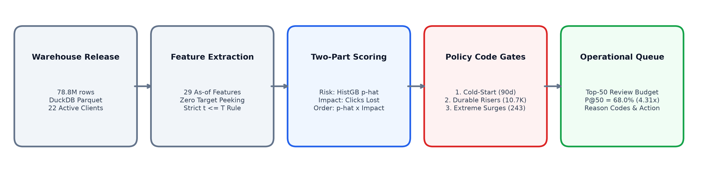
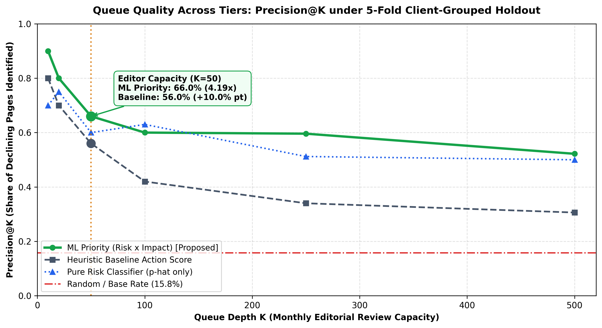
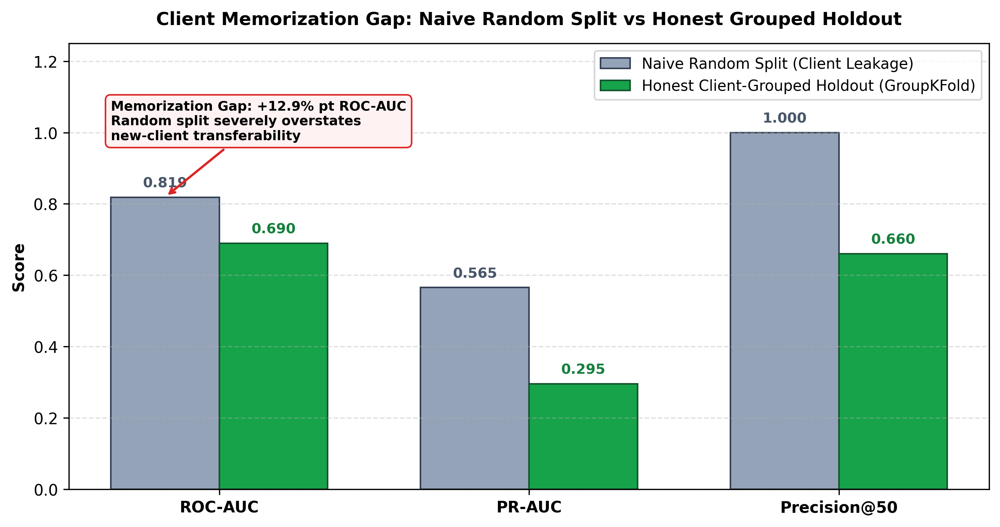
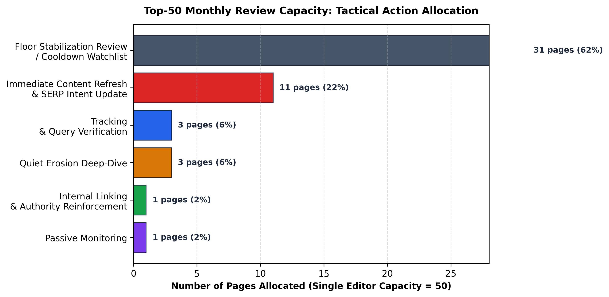

# Page Priority Pipeline

### Enterprise Decision-Support Ranker for Organic Search Content Decline

[](https://www.python.org/)
[](https://duckdb.org/)
[](https://scikit-learn.org/)
[-success.svg)](#operational-queue-benchmarks)
[](#4-the-client-memorization-gap-validation-rigor)
[-blue.svg)](#6-reproduction--notebook-execution-guide)

An enterprise applied machine learning ranking system that analyzes **78.8M+ search performance facts** across 22 client domains to prioritize monthly editorial content reviews under finite human capacity (50 in-depth page audits per editor/month).

The pipeline combines **calibrated gradient-boosted decline probabilities** with **empirical click loss exposure** (`Priority = p̂ × Impact × (1 + max(0, Δpos))`), outperforming heuristic baselines by **+10.0% percentage points at monthly budget depth** (K = 50) and maintaining a **+71% relative yield advantage** across wide review queues (K = 500).

---

## Quick Links

- 🌐 **[Live Interactive Case Study](https://kab-s.github.io/flyrank-page-priority-pipeline/)** ([`index.html`](/index.html)) — Deployed interactive case study.
- 📄 **[Technical Capstone Paper (`work/capstone_report.md`)](work/capstone_report.md)** — Formal publication report with receipts, methodology, and claim boundaries.
- 📓 **[Authored Research Notebooks (`work/notebooks/`)](work/notebooks/)** — 10 progressive notebooks (w01–w07, capstone) implementing the pipeline from hypothesis to action playbook.

---

## Executive Scorecard & Key Results

| Metric / Dimension | Audited Result | Ground-Truth Detail |
|---|:---:|---|
| **Warehouse Scale** | **78,835,655 rows** | Daily GSC/GA4 performance facts across 104 client domains (DuckDB Parquet) |
| **Evaluation Cohort** | **38,271 URLs** | Active content items across 22 mature client domains at monthly boundary T = 2026-02-01 |
| **Observed Base Rate** | **15.76%** | 6,032 URLs experienced >20% organic impression drop in forward 30-day window [T+1, T+30] |
| **Top-10 Precision (K = 10)** | **90.00% (5.71× lift)** | 9/10 true declines captured at queue head vs 80.00% heuristic baseline |
| **Editor Monthly Budget (K = 50)** | **66.00% (4.19× lift)** | **+10.0% pt lift** over baseline (56.00%), capturing 33 true declines and 37.6 clicks saved |
| **Queue Depth (K = 500)** | **52.20% (3.31× lift)** | **+70.6% (~+71%) relative yield advantage** over baseline (30.60%) by capturing non-linear decay signals |
| **Client Memorization Gap** | **+12.89% pt ROC-AUC** | Severe leakage exposed under naive random splits; honest 5-fold `GroupKFold` enforced |
| **Adversarial Leakage Audit** | **4 / 4 PASS (0 flaws)** | Invariant t ≤ T cutoff, zero entity IDs, ablation resistance, and synthetic leak sensitivity |
| **Operational Code Gates** | **3 Non-Bypassable Gates** | 100% cold-start compliance, 10,753 durable risers protected, 243 extreme spikes verified |
| **Two-Clock Drift Telemetry** | **PSI = 0.0558** | Input distribution drift well below 0.10 threshold; realized base rate within safe operating band |

---

## 1. The Problem: Content Triage Under Finite Editorial Capacity

Enterprise content agencies manage tens of thousands of published articles across diverse client domains. Over time, search traffic decays due to query intent drift, algorithmic updates, competitor refreshes, and internal content staleness.

### The Editorial Capacity Bottleneck
- A senior SEO specialist or content editor has an operational throughput limit of **50 in-depth page audits per month**.
- A thorough content audit requires 4–8 hours of expert human labor (SERP competitor analysis, intent mapping, internal link inspection, copy revision).
- Manually scanning 38,000+ live URLs is impossible. Teams require a prioritized, trusted queue that answers: **"Which 50 pages should an editor audit this month to preserve the maximum search traffic?"**

```
                         INDIVIDUAL EDITOR MONTHLY CAPACITY = 50 PAGES
                                             │
             ┌───────────────────────────────┴───────────────────────────────┐
             ▼                                                               ▼
  Unassisted / Naive Triage                                     Page Priority Pipeline
  • Triage by Raw Traffic Volume: Reviews giant                • Order by Expected Utility: Priority = p̂ × Impact
    evergreen pages; ignores quiet erosions.                   • Filter by 3 Asserted Code Gates: Protects risers.
  • Triage by Recent Percentage Dip: Chases mean-              • Action Taxonomy: Model supplies order; audited
    reversion bounces; 66.2% hit structural floor.               rule supplies transparent reason code.
  Result: Severe false-positive edit fatigue.                  Result: Precision@50 = 66.0% (4.19× lift over base).
```

### The "Anti-Baseline" Trap (Why Simple Rules Fail)
The most common industry practice is targeting pages with the largest recent traffic drops ("already dipping" watchlist). When audited against ground-truth warehouse receipts:
- **66.22% of retrospective dippers hit a structural floor and rebound** or stabilize over the subsequent 30 days. Only 33.78% continue downward.
- Relying on retrospective dips missed **70.32% of forward collapses** (4,242 unflagged collapsing URLs).
- Result: Editors waste two-thirds of their monthly capacity on pages whose decline has already concluded, while quiet, compounding erosions go unaddressed.

### The Solution: Two-Part Expected Utility Framework
The pipeline decouples ranking into an empirical risk classifier and an impact estimator:
$$\text{Priority Score} = \hat{p}(\text{decline}) \times \text{Expected Clicks Lost} \times \left(1 + \max(0, \Delta\text{pos})\right)$$

This mathematical formulation prevents two major operational failure modes:
1. It ignores high-traffic evergreen articles that are structurally secure (`p̂ ≈ 0`).
2. It ignores low-volume tail URLs that have 95% decline probability but only 3 monthly impressions (`Impact ≈ 0`).

---

## 2. End-to-End System Architecture

The pipeline is implemented and documented across modular research notebooks in `work/notebooks/`, querying the warehouse through DuckDB:

```
┌──────────────────────────────────────────────────────────────────────────────────────────────┐
│                                   PAGE PRIORITY PIPELINE                                     │
└──────────────────────────────────────────────────────────────────────────────────────────────┘
                                                │
   1. INGESTION & ELIGIBILITY                   ▼
   ┌──────────────────────────────────────────────────────────────────────────────────────────┐
   │ DuckDB over 78.8M Parquet Records                                                        │
   │ • Volume Floor (≥ 100 baseline impr)       • GSC Coverage (≥ 25 active reporting days)   │
   │ • Content Maturity (≥ 90d published age)   • Client Maturity (≥ 90d client tenure)       │
   │ Cohort: 38,271 eligible URLs across 22 client domains at cutoff T = 2026-02-01           │
   └──────────────────────────────────────────────────────────────────────────────────────────┘
                                                │
   2. FEATURE EXTRACTION & SAFETY               ▼
   ┌──────────────────────────────────────────────────────────────────────────────────────────┐
   │ 29 Point-in-Time Features (strictly t ≤ T)                                               │
   │ • Search Momentum (7)   • Traffic Level & Concentration (6)   • Peak Distance (4)        │
   │ • User Engagement (6)   • Scale-Free SERP Profile (6)                                    │
   │ Adversarial Leakage Suite: SQL Timeline Boundary (0 overlap), Column Quarantines,        │
   │ Excluded CMS Timestamps & Entity Identifiers, Suspect Ablation Test (0.0025 ΔAUC)        │
   └──────────────────────────────────────────────────────────────────────────────────────────┘
                                                │
   3. TOURNAMENT & VALIDATION                   ▼
   ┌──────────────────────────────────────────────────────────────────────────────────────────┐
   │ 5-Fold Out-of-Domain Client Holdout (GroupKFold by client_hash_id + Inverse Weighting)   │
   │ • Baseline Heuristic Action Score:  ROC-AUC = 0.5815, P@50 = 56.00%                      │
   │ • Regularized Logistic Regression:  ROC-AUC = 0.5690, P@50 = 42.00%                      │
   │ • HistGradientBoosting (Champion):  ROC-AUC = 0.6898, P@50 = 66.00%                      │
   └──────────────────────────────────────────────────────────────────────────────────────────┘
                                                │
   4. OPERATIONAL CODE GATES                    ▼
   ┌──────────────────────────────────────────────────────────────────────────────────────────┐
   │ Gate 1: Cold-Start Qualification (≥ 90d page age & client tenure; 100% PASS)             │
   │ Gate 2: Durable-Trend Protection (10,753 rising URLs clamped to Passive Monitoring)      │
   │ Gate 3: Extreme Volume Verification (243 spike URLs routed to Tracking Audit)            │
   └──────────────────────────────────────────────────────────────────────────────────────────┘
                                                │
   5. ACTION TAXONOMY & TELEMETRY               ▼
   ┌──────────────────────────────────────────────────────────────────────────────────────────┐
   │ "Model Supplies the Order; Audited Rule Supplies the Reason"                             │
   │ Ranked Priority Queue + Reason Codes (RC_CTR_SLIP, RC_POS_DECAY, RC_MOMENTUM_COLLAPSE)   │
   │ Two-Clock Telemetry: Pre-release Feature PSI (0.0558) + Post-label Base Rate (15.76%)    │
   └──────────────────────────────────────────────────────────────────────────────────────────┘
```



---

## 3. Operational Queue Benchmarks

In production, editorial teams do not evaluate abstract metrics like ROC-AUC; they consume an ordered queue. The table below compares the audited **Heuristic Baseline** (Δclicks₂₈), a **Pure Risk Classifier** (p̂ only), and the proposed **Two-Part ML Priority Ranker** across multiple operational review depths:

| Queue Depth (K) | Operational Review Workflow | Heuristic Baseline P@K | Pure Risk Classifier P@K | Proposed ML Priority P@K | ML Lift over Base Rate | ML Yield vs Baseline |
|:---:|:---|:---:|:---:|:---:|:---:|:---:|
| **K = 10** | Head-of-Queue Urgent Triage | 80.00% | 70.00% | **90.00%** | **5.71×** | **+12.5%** |
| **K = 20** | Bi-Weekly Sprint Review | 70.00% | 75.00% | **80.00%** | **5.08×** | **+14.3%** |
| **K = 50** | **Single Editor Monthly Budget** | 56.00% | 60.00% | **66.00%** | **4.19×** | **+17.9% (+10.0% pt)** |
| **K = 100** | Multi-Editor Content Team | 42.00% | 63.00% | **60.00%** | **3.81×** | **+42.9%** |
| **K = 250** | Quarterly Client Strategy Audit | 34.00% | 51.20% | **59.60%** | **3.78×** | **+75.3%** |
| **K = 500** | Wide Portfolio Risk Scan | 30.60% | 50.00% | **52.20%** | **3.31×** | **+70.6% (+71%)** |



### Key Evaluation Insights
1. **At Single Editor Capacity (K = 50):** ML Priority delivers **66.00% precision (4.19× lift)**, capturing 33 true declining URLs and preserving 37.6 expected monthly clicks, beating the heuristic baseline (56.00%) by **+10.00 percentage points**.
2. **At Queue Depth (K = 500):** While the baseline drops toward 30.60%, ML sustains **52.20% precision**, demonstrating a **+71% relative yield advantage** by identifying subtle, compounding erosions (e.g., SERP rank drift interacting with CTR decay) that if-statements cannot catch.
3. **The Failure of Pure Risk:** Ranking solely by probability p̂ floods the queue with low-volume tail URLs (e.g., 5 impressions dropping to 0) that have high certainty but near-zero business recovery value. The utility formulation ensures high-impact URLs are prioritized.

---

## 4. The Client Memorization Gap (Validation Rigor)

A central finding of this research is that **naive random train/test splits catastrophically overestimate out-of-domain generalization** in multi-tenant ranking systems. Decision trees split on subtle client fingerprints (such as `client_share_of_traffic` or average impression volume), effectively memorizing client identity.

To quantify this error, the champion model architecture was evaluated under both validation designs on the warehouse cohort:

| Validation Design | Split Logic | ROC-AUC | PR-AUC | Precision@50 | Lift@50 |
|---|---|:---:|:---:|:---:|:---:|
| **Naive Random Split** | 80/20 random row split | 0.8187 | 0.5653 | 100.00% | 6.34× |
| **Honest Client Holdout** | 5-Fold `GroupKFold` by domain | **0.6898** | **0.2953** | **66.00%** | **4.19×** |
| **Client Memorization Gap** | **Leakage Inflation** | **+12.89% pt** | **+27.00% pt** | **+34.00% pt** | **+2.15×** |



> **Applied ML Principle:** Random row splits inflate ROC-AUC by **+12.89 percentage points**. An ML system trained and evaluated on naive random splits will suffer immediate degradation upon onboarding new client domains. All production claims and scorecards in this repository are reported strictly under honest 5-fold out-of-domain client-grouped validation.

---

## 5. Action Taxonomy: "Model = Order, Rule = Reason"

Machine learning models predict decline probabilities, but editorial teams need specific, actionable interventions. To build trust and prevent edit fatigue, the pipeline strictly separates ranking from recommendation:
- **The Machine Learning Model Supplies the Order:** Expected utility determines which URLs appear first.
- **Audited Deterministic Rules Supply the Reason:** Pre-registered reason codes assign each page to a specific tactical action category.

### Breakdown of the Top-50 Monthly Editorial Queue

| Tactical Action Category | Top-50 Share | Prescribed Editorial Playbook | Trigger Reason Code |
|---|:---:|---|---|
| **Floor Stabilization Review / Cooldown** | **62.0%** (31 pages) | Verify whether page hit a structural floor; prevent premature rewrite | `RC_POS_DECAY`, `RC_MOMENTUM_COLLAPSE` |
| **Immediate Content Refresh & Intent Update** | **22.0%** (11 pages) | Comprehensive overhaul targeting competitor SERP gains & lost query intent | `RC_CTR_SLIP`, `RC_POS_DECAY` |
| **Tracking & Query Verification** | **6.0%** (3 pages) | Audit analytics/GSC tagging and query surges before authorizing edits | `RC_INDEX_VOLATILITY`, extreme surge |
| **Quiet Erosion Deep-Dive** | **6.0%** (3 pages) | Detailed audit of multi-signal decay unflagged by simple heuristics | `RC_MOMENTUM_COLLAPSE` |
| **Internal Linking & Authority Reinforcement** | **2.0%** (1 page) | Add contextual internal links from high-authority pillar pages | `RC_POS_DECAY` |
| **Passive Monitoring** | **2.0%** (1 page) | Stable control observation; no editorial intervention permitted | Protected durable riser |



---

## 6. Reproduction & Notebook Execution Guide

The primary research, experiments, and model pipelines in this repository were authored directly in Jupyter notebooks located in [`work/notebooks/`](work/notebooks/). 

### 1. Environment Setup
Clone the repository and install dependencies in a clean virtual environment (Python 3.10+):
```bash
git clone https://github.com/kab-s/flyrank-page-priority-pipeline.git
cd flyrank-page-priority-pipeline

# Create and activate virtual environment
python -m venv .venv
# On Linux/macOS:
source .venv/bin/activate
# On Windows PowerShell:
.venv\Scripts\Activate.ps1

# Install project dependencies
pip install -r requirements.txt
```

### 2. Authored Notebook Index (`work/notebooks/`)
All research milestones are organized as executable notebooks. Each notebook can be run locally in Jupyter Lab / VS Code or in Google Colab:

| Notebook | Milestone | Topic & Purpose | Colab |
|---|:---:|---|:---:|
| [`w01_research_question.ipynb`](work/notebooks/w01_research_question.ipynb) | ML-02 | Research question framing, decision context, and starter dataset exploration | [](https://colab.research.google.com/github/kab-s/flyrank-page-priority-pipeline/blob/main/work/notebooks/w01_research_question.ipynb?flush_cache=true) |
| [`w02_ml_task_framing.ipynb`](work/notebooks/w02_ml_task_framing.ipynb) | ML-03 | Framing the problem as a ranked queue, unit of analysis, and asymmetric error costs | [](https://colab.research.google.com/github/kab-s/flyrank-page-priority-pipeline/blob/main/work/notebooks/w02_ml_task_framing.ipynb?flush_cache=true) |
| [`w03_data_contract.ipynb`](work/notebooks/w03_data_contract.ipynb) | ML-04 | Warehouse data contract, table joins, eligibility criteria, and grain verification | [](https://colab.research.google.com/github/kab-s/flyrank-page-priority-pipeline/blob/main/work/notebooks/w03_data_contract.ipynb?flush_cache=true) |
| [`w03_feature_leakage_check.ipynb`](work/notebooks/w03_feature_leakage_check.ipynb) | ML-05 | 29 Point-in-time features extraction and 4-vector adversarial leakage defense | [](https://colab.research.google.com/github/kab-s/flyrank-page-priority-pipeline/blob/main/work/notebooks/w03_feature_leakage_check.ipynb?flush_cache=true) |
| [`w04_signal_audit.ipynb`](work/notebooks/w04_signal_audit.ipynb) | ML-06 | Empirical signal audit: testing decay signals, velocity ratios, and position drift | [](https://colab.research.google.com/github/kab-s/flyrank-page-priority-pipeline/blob/main/work/notebooks/w04_signal_audit.ipynb?flush_cache=true) |
| [`w04_baseline_score.ipynb`](work/notebooks/w04_baseline_score.ipynb) | ML-07 | Heuristic velocity decay baseline action score and anti-baseline audit | [](https://colab.research.google.com/github/kab-s/flyrank-page-priority-pipeline/blob/main/work/notebooks/w04_baseline_score.ipynb?flush_cache=true) |
| [`w05_model.ipynb`](work/notebooks/w05_model.ipynb) | ML-08 | Candidate model tournament (Logistic Regression vs HistGBDT) under 5-fold GroupKFold | [](https://colab.research.google.com/github/kab-s/flyrank-page-priority-pipeline/blob/main/work/notebooks/w05_model.ipynb?flush_cache=true) |
| [`w06_validation_audit.ipynb`](work/notebooks/w06_validation_audit.ipynb) | ML-09 | Validation audit, client memorization gap analysis, and claim boundary rewrite | [](https://colab.research.google.com/github/kab-s/flyrank-page-priority-pipeline/blob/main/work/notebooks/w06_validation_audit.ipynb?flush_cache=true) |
| [`w07_action_playbook.ipynb`](work/notebooks/w07_action_playbook.ipynb) | ML-10 | Tactical action playbook, operational code gates, and two-clock telemetry (PSI) | [](https://colab.research.google.com/github/kab-s/flyrank-page-priority-pipeline/blob/main/work/notebooks/w07_action_playbook.ipynb?flush_cache=true) |
| [`capstone.ipynb`](work/notebooks/capstone.ipynb) | ML-11 / 12 | **Consolidated capstone pipeline** reproducing all benchmark tables and figures | [](https://colab.research.google.com/github/kab-s/flyrank-page-priority-pipeline/blob/main/work/notebooks/capstone.ipynb?flush_cache=true) |

### 3. Execution & Warehouse Access Requirements

> [!IMPORTANT]
> **Hugging Face Token & Warehouse Access:**
> Re-executing the full warehouse extraction and capstone modeling notebooks (`w03`–`w07`, `capstone.ipynb`) queries the proprietary FlyRank Search Intelligence Warehouse hosted on Hugging Face (`hf://datasets/FlyRank/internship-warehouse`). Executing these queries requires an authorized Hugging Face access token (`HF_TOKEN`) with read permissions to FlyRank's gated dataset.
>
> In accordance with enterprise data security standards and internship agreements, **proprietary `HF_TOKEN` credentials cannot and will not be shared in this public repository**.
>
> **How to review and verify this repository:**
> - **Pre-Executed Verified Receipts:** All notebooks in [`work/notebooks/`](work/notebooks/) are committed with their complete, audited execution logs, benchmark evaluation tables, and figures fully intact. Reviewers can inspect every step directly on GitHub without re-running against the remote warehouse.
> - **Token-Free Offline Execution:** The initial exploratory notebooks ([`w01`](work/notebooks/w01_research_question.ipynb), [`w02`](work/notebooks/w02_ml_task_framing.ipynb)) and the reference baseline pipeline in [`scripts/`](scripts/) (`python scripts/run_all.py`) execute completely offline using the bundled anonymized starter dataset ([`data/raw/content_refresh_anonymized.csv`](data/raw/content_refresh_anonymized.csv)) without requiring any Hugging Face token or external network connectivity.
> - **Authorized Evaluators:** Evaluators possessing FlyRank dataset credentials can run the full pipeline by setting their token in the environment (`$env:HF_TOKEN = "your_token"` in PowerShell, or `export HF_TOKEN="your_token"` in Bash) or via Google Colab Secrets (`userdata.get('HF_TOKEN')`).

### 4. Running the End-to-End Capstone
To inspect the consolidated experimental pipeline:
1. Launch Jupyter Notebook or JupyterLab:
   ```bash
   jupyter lab work/notebooks/capstone.ipynb
   ```
2. Inspect the pre-rendered cells or execute them sequentially (if an authorized `HF_TOKEN` is configured). The notebook loads the cohort via DuckDB, performs the 4-part leakage audit, executes 5-fold client-grouped validation, verifies operational code gates, and renders all evaluation charts.

> [!NOTE]
> The scripts inside `scripts/` (`01_prepare_features.py` through `05_build_pdf_report.py`) represent the reference starter pipeline that runs on the bundled sample CSV (`data/raw/content_refresh_anonymized.csv`). All authored research, feature engineering, out-of-domain validation, and capstone modeling live inside `work/notebooks/`.

---

## 7. Repository Structure

```
.
├── README.md                              <- Production repository overview & technical summary
├── DATA_USE.md                            <- Data usage policy & public-safety boundary rules
├── index.html                             <- Interactive case study web report (GitHub Pages)
├── LICENSE                                <- Open source license
├── requirements.txt                       <- Python dependencies
│
├── data/
│   └── raw/
│       └── content_refresh_anonymized.csv <- Bundled starter sample dataset (30,000 rows)
│
├── img/                                   <- Publication figures embedded in README and report
│   ├── fig_capstone_pipeline.png          <- Pipeline architecture diagram
│   ├── fig_capstone_precision_at_k.png    <- Precision@K comparison curve
│   ├── fig_capstone_split_gap.png         <- Client memorization gap visualization
│   └── fig_capstone_action_mix.png        <- Top-50 action category allocation
│
├── submission/
│   ├── README.md                          <- Capstone submission instructions
│   └── paper_url.txt                      <- Deployed research report URL
│
├── work/
│   ├── README.md                          <- Workspace rules and assignment index map
│   ├── capstone_report.md                 <- Formal publication report with receipts
│   ├── capstone_report_template.md        <- Capstone report grading template
│   ├── explore_for_research_question.py   <- Initial exploratory helper script
│   └── notebooks/                         <- Authored research & modeling notebooks
│       ├── w01_research_question.ipynb    <- Phase 1: Research question & data analysis
│       ├── w02_ml_task_framing.ipynb      <- Phase 2: ML task framing & unit of analysis
│       ├── w03_data_contract.ipynb        <- Phase 3A: Search intelligence data contract
│       ├── w03_feature_leakage_check.ipynb<- Phase 3B: Feature vector & leakage audit
│       ├── w04_signal_audit.ipynb         <- Phase 4A: Empirical signal audit
│       ├── w04_baseline_score.ipynb       <- Phase 4B: Heuristic baseline action score
│       ├── w05_model.ipynb                <- Phase 5: Candidate model tournament
│       ├── w06_validation_audit.ipynb     <- Phase 6: Validation audit & memorization gap
│       ├── w07_action_playbook.ipynb      <- Phase 7: Action playbook & code gates
│       └── capstone.ipynb                 <- Phase 8: Consolidated capstone pipeline
│
├── outputs/                               <- Reference starter pipeline outputs
│   ├── model_report.md                    <- Summary report from reference starter pipeline
│   ├── refresh_queue_sample.csv           <- Sample output queue
│   └── charts/                            <- Reference starter pipeline charts
│
└── scripts/                               <- Reference starter pipeline scripts
    ├── 01_prepare_features.py             <- Step 1: Feature preparation on starter sample
    ├── 02_baseline_score.py               <- Step 2: Reference rule-based scoring
    ├── 03_train_model.py                  <- Step 3: Reference model training
    ├── 04_evaluate_and_export.py          <- Step 4: Reference queue evaluation
    ├── 05_build_pdf_report.py             <- Step 5: Reference PDF report generator
    ├── ml_utils.py                        <- Reference shared utilities
    └── run_all.py                         <- Reference pipeline runner
```

---

## 8. Responsible ML & Non-Causal Boundaries

To maintain technical credibility in enterprise production environments, this pipeline strictly adheres to the **FlyRank Non-Causal Claim Ladder**:

- **What Is Claimed and Proven:** Offline Precision@50 of **66.00% (4.19× lift)** demonstrates that the Two-Part Expected Utility ranker accurately enriches declining URLs for human review, outperforming rule-based baselines across all queue depths (K = 10 to K = 500). The client memorization gap (+12.89% pt ROC-AUC) proves the necessity of out-of-domain group holdout validation.
- **What Is Explicitly NOT Claimed:**
  - *No Causal Recovery Claim:* We do not claim that rewriting these articles will causally reverse traffic decline or recover lost clicks. Proving causal refresh lift requires a prospective randomized controlled trial (A/B experiment).
  - *No Google Algorithm Reverse-Engineering:* We do not claim to predict search engine ranking updates. The model detects empirical statistical momentum shifts in Search Console telemetry.
- **Human-in-the-Loop Safeguard:** This pipeline operates strictly as a decision-support system to allocate scarce human attention. Zero automated content modifications or de-indexations occur without expert human review.

---

## Data Credit & Acknowledgments

This project was developed on the **FlyRank Search Intelligence Warehouse**, provided as part of the FlyRank Applied Machine Learning Internship.

- **Data Provider:** [FlyRank AI](https://flyrank.ai)
- **Dataset Scope:** 78,835,655 pseudonymized Search Console and GA4 daily performance facts (2025-01-27 to 2026-06-30).
- **Engineering Standards:** Built in compliance with Google Rules of ML, enterprise data privacy standards (zero plain client or query strings), and rigorous out-of-domain cross-validation.
